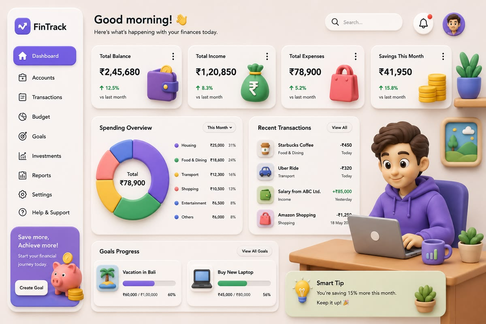

# FinTrack — 3D Claymorphic Personal Finance Dashboard | لوحة التحكم المالية الذكية

<div align="center">
  
</div>

---

## 🌟 Overview | نبذة عن المشروع

**FinTrack** is a tactile **3D Claymorphic Personal Finance Dashboard** built with React 19, TypeScript, Tailwind CSS v4, and Recharts. It features full bilingual support (**Arabic RTL** by default & **English LTR**), interactive spending breakdowns, 6-month income vs. expense analytics, gamified savings goal milestones (`50%`, `75%`, `100%`), and dismissible smart financial tips with local state persistence.

**FinTrack** هي لوحة تحكم مالية شخصية بتصميم **طيني ثلاثي الأبعاد (3D Claymorphism)**، مبنية باستخدام React 19 وTypeScript وTailwind CSS v4 ومكتبة الرسوم البيانية Recharts. تدعم اللغتين **العربية (RTL)** كوضع افتراضي و**الإنجليزية (LTR)** بالكامل، مع تحليلات الإنفاق التفاعلية، ومخطط مقارنة الدخل والمصروفات لآخر 6 أشهر، ونظام تحفيز ومكافآت لتقدم الأهداف المالية (`50%`، `75%`، `100%`).

---

## ✨ Key Features | المميزات الرئيسية

### 1. Tactile 3D Claymorphic UI | واجهة طينية ثلاثية الأبعاد
- Warm cream-beige canvas (`#EFE5DE`) paired with soft inner specular highlights, diffused drop shadows, and custom 3D clay illustrations for wallets, rupee money bags, shopping bags, gold coins, piggy banks, and workspace scenes.
- Fully responsive Bento Grid layout across Mobile (`< 640px`), Tablet (`640px–1023px`), Laptop (`1024px–1279px`), and Desktop (`1280px+`).

### 2. Full Arabic (RTL) & English (LTR) Localization | دعم كامل للعربية والإنجليزية
- Native Right-to-Left (`dir="rtl"`) layout with `Cairo` and `Tajawal` typography for Arabic and `Plus Jakarta Sans` for English.
- Instant header language switcher (`EN` / `عربي`) that updates direction, charts, notifications, modals, and all 9 navigation sections.
- Interactive **Notification Bell Center (مركز الإشعارات المالية)** with live unread badge, Arabic/English financial alerts, and one-click mark-as-read.

### 3. 6-Month Income vs. Expenses Bar Chart (`recharts`) | مخطط الدخل مقابل المصروفات
- Custom 3D SVG bar renderer (`ClayBarShape`) with rounded caps, inner specular highlights, and ambient shadows.
- Interactive `Last 6 Months` / `Last 3 Months` toggle, RTL/LTR axis orientation, and claymorphic tooltips showing net savings and savings rate.

### 4. Gamified Goal Progress Milestones | تحفيز ومكافآت تقدم الأهداف
- Recessed 3D progress tracks with `50%` and `75%` milestone notch markers.
- Automatic shimmer animation (`.clay-milestone-shimmer`), milestone badges (`Sparkles` at `50%`, `Flame` at `75%`, `Trophy` + gold bar fill at `100%`), celebration toast banners, and a quick `+₹10k` boost button.

### 5. Dismissible Smart Tips with Local Persistence | نصائح ذكية قابلة للإخفاء
- Interactive **Smart Tip (نصيحة ذكية)** card with a corner `'x'` button to dismiss/hide the current tip.
- Automatically saves user preferences to React state and `localStorage` (`fintrack_dismissed_tips`, `fintrack_smart_tip_hidden`) with a one-click restore pill (**إظهار النصيحة الذكية** / **Show Smart Tip**).

---

## 🗂️ Project Structure | هيكل المشروع

```text
├── public/
│   └── assets/
│       ├── aistudio/
│       │   └── image_2a104831.png       # Visual design reference
│       └── fintrack/                    # 3D claymorphic transparent PNG assets
│           ├── avatar.png
│           ├── character_desk.png
│           ├── coins.png
│           ├── donut_3d.png
│           ├── goal_bali.png
│           ├── goal_laptop.png
│           ├── money_bag.png
│           ├── piggy_bank.png
│           ├── shopping_bag.png
│           ├── tip_bulb.png
│           ├── tip_plant.png
│           ├── tx_bag.png
│           ├── tx_car.png
│           ├── tx_coffee.png
│           ├── tx_wallet.png
│           └── wallet.png
├── src/
│   ├── components/
│   │   ├── Sidebar.tsx                  # Responsive mobile top bar + desktop clay sidebar
│   │   ├── GoalProgressCard.tsx         # Gamified 50%/75%/100% milestone goal cards
│   │   ├── IncomeExpenseChart.tsx       # 6-month Recharts 3D clay bar chart
│   │   ├── FinanceModals.tsx            # Create Goal, Add Transaction & Top-Up modals
│   │   └── SecondaryViews.tsx           # Accounts, Transactions, Budget, Goals, Reports, etc.
│   ├── data/
│   │   └── financeData.ts               # Bilingual (AR/EN) financial datasets & helpers
│   ├── App.tsx                          # Main dashboard shell, state & RTL/LTR orchestration
│   ├── index.css                        # 3D claymorphic surface & animation styles
│   └── main.tsx                         # React application entry point
├── index.html
├── package.json
├── tsconfig.json
└── vite.config.ts
```

---

## 🚀 Getting Started | طريقة التشغيل

### Prerequisites | المتطلبات
- **Node.js** `>= 18.x`
- **npm** `>= 9.x`

### Installation | التثبيت

```bash
# Install dependencies
npm install
```

### Development Server | تشغيل بيئة التطوير

```bash
# Start Vite dev server on port 3000
npm run dev
```

### Build & Typecheck | البناء وفحص الأنواع

```bash
# TypeScript typecheck
npm run lint

# Production bundle build
npm run build
```

---

## 🛠️ Tech Stack | التقنيات المستخدمة

- **Framework**: React 19 + TypeScript + Vite
- **Styling**: Tailwind CSS v4 + Custom 3D Claymorphic CSS Surfaces
- **Charts**: Recharts (`ResponsiveContainer`, `BarChart`, Custom SVG 3D `ClayBarShape`)
- **Icons**: Lucide React
- **Typography**: `Cairo`, `Tajawal`, `Plus Jakarta Sans`, `JetBrains Mono`
